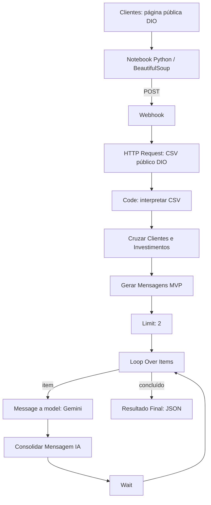

# Assistente de Investimentos com RPA, n8n e IA Generativa

Entrega do desafio DIO [Criando um Assistente de Investimentos com RPA e IA Generativa](https://github.com/digitalinnovationone/dio-lab-assistente-investimentos-rpa-n8n).
O projeto extrai clientes fictícios de HTML, cruza perfil e saldo com produtos
de um CSV e prepara mensagens educativas. Usa integração direta com Gemini
2.5 Flash no nó **Message a model**. Não implementa nó **AI Agent** nem agente
autônomo.

O workflow original teve execução bem-sucedida relatada no n8n 2.44.6 Self
Hosted via Docker. A importação e execução da versão pública sanitizada, após
a correção da referência de credencial, ainda não foram integralmente validadas.
O limite de processamento com IA é de dois clientes por execução.

## Objetivo e arquitetura

Automatizar coleta, seleção determinística de produtos e redação de mensagens,
mantendo a regra de correspondência separada da reescrita pelo LLM.



O JSON final é consultado na saída de **Resultado Final - Mensagens IA** no
editor. Não há envio de e-mail ou gravação em arquivo. O HTTP 200 do notebook
confirma o aceite do POST, não a conclusão da IA: o Webhook não está configurado
para devolver o resultado consolidado.

## Tecnologias e estrutura

| Tecnologia | Uso |
| --- | --- |
| Python 3.12, Requests, BeautifulSoup | Coleta HTML e envio HTTP |
| Jupyter Notebook | Execução interativa do RPA |
| n8n 2.44.6 Self Hosted / Docker | Ambiente informado da execução original |
| JavaScript em nós Code | Conversão, correspondência, template e consolidação |
| Gemini 2.5 Flash | Reescrita da mensagem estática |
| GitHub Pages da DIO | Fontes públicas de clientes e produtos |

```text
.
├── README.md
├── .gitignore
├── docs/
│   ├── evidencias/
│   │   ├── README.md
│   │   ├── workflow-execucao-sucesso.png
│   │   └── resultado-gemini-json.png
│   ├── index.html
│   └── data.csv
├── n8n/
│   ├── README.md
│   └── workflow.json
└── rpa/
    └── extrair_clientes.ipynb
```

O notebook está em `rpa/`, apesar das referências a `src/` no roteiro original.
`.venv/` é local e ignorado. Não há `requirements.txt` ou Compose. As duas
capturas reais da execução original estão em `docs/evidencias/`.

## Preparar o Python

Pré-requisitos: Python 3.12, acesso à internet para as fontes DIO, Docker para
o n8n e credencial Gemini com modelo e cota disponíveis. A referência local
pressupõe Python na mesma máquina que publica a porta do n8n.

Na raiz do repositório, em PowerShell:

```powershell
py -3.12 -m venv .venv
.\.venv\Scripts\python.exe -m pip install requests beautifulsoup4 notebook
.\.venv\Scripts\python.exe -m notebook rpa/extrair_clientes.ipynb
```

Selecione o kernel desse ambiente. As dependências não estão fixadas; as saídas
salvas registram Requests 2.32.4 e BeautifulSoup 4.13.5. A célula inicial do
notebook também contém `!pip install requests beautifulsoup4`.

## n8n, importação e Gemini

Estas instruções são para reprodução manual futura. Executar a célula de envio
dispara o fluxo e pode consumir cota do Gemini.

Se já existe um container local, inicie-o pelo Docker Desktop ou com
`docker start NOME_DO_CONTAINER`, usando seu nome real. Preserve sua configuração
e volume. Acesse o editor na porta publicada, normalmente `http://localhost:5678`.

Para uma instalação nova e isolada, um exemplo é:

```powershell
docker volume create dio_n8n_data
docker run -d --name dio-n8n -p 127.0.0.1:5678:5678 -v dio_n8n_data:/home/node/.n8n docker.n8n.io/n8nio/n8n:2.44.6
```

O exemplo não foi executado nesta revisão. Requer nome/porta livres e a imagem
indicada disponível; não substitui a instalação de desenvolvimento. Conclua a
configuração inicial pelo editor, se necessário.

1. Use **Import from File** e selecione [n8n/workflow.json](n8n/workflow.json).
2. Confira os 11 nós e as versões declaradas no JSON.
3. Abra **Message a model** e selecione uma credencial Google Gemini existente
   ou crie uma no gerenciador do n8n (tipo interno `googlePalmApi`). Cadastre a
   chave somente nesse gerenciador, nunca no JSON ou notebook.
4. Confirme `models/gemini-2.5-flash` e salve. O nó não contém a propriedade
   `credentials` no JSON público; a seleção manual é necessária.
5. Confira Webhook e Wait, cujos identificadores locais foram removidos, e
   valide a importação na instalação de destino antes de ativar.

O JSON permanece inativo. A referência anterior com `id: null`, associada ao
erro de credencial inválida, foi removida. Não houve nova importação real nesta
auditoria. Consulte também [as notas do workflow](n8n/README.md).

## Webhook e integração com o notebook

O Webhook recebe POST em `dio-investimentos`. A célula final do notebook já
envia um payload com `origem`, `total_clientes` e `clientes`, usando timeout de
30 segundos e `raise_for_status()`. O TODO comentado na célula de extração é
remanescente; existe uma célula posterior com envio implementado.

Para teste manual, coloque o Webhook em escuta no editor e execute extração,
contagem e envio nessa ordem. A variável existente é:

```python
WEBHOOK_URL = "http://localhost:5678/webhook-test/dio-investimentos"
```

Para produção, publique/ative conforme a interface da instalação e copie a URL
de produção exibida pelo nó (normalmente `/webhook/dio-investimentos`). Ajustar
a variável é uma etapa de configuração pelo usuário; o notebook não foi
alterado nesta revisão.

`localhost` identifica a máquina do kernel Python. Em Colab, outro computador
ou outro container, esse endereço não aponta automaticamente para o n8n local.
É necessário endereço alcançável e configuração de acesso apropriada. O Webhook
exportado não configura autenticação; revise o acesso antes de expô-lo publicamente.

O código consulta as fontes públicas DIO, mesmo existindo cópias em `docs/`.
Alterar somente essas cópias não altera a coleta remota:

- [Clientes](https://digitalinnovationone.github.io/dio-lab-assistente-investimentos-rpa-n8n/).
- [Investimentos CSV](https://digitalinnovationone.github.io/dio-lab-assistente-investimentos-rpa-n8n/data.csv).

## Nós e regras implementadas

| Nó | Comportamento |
| --- | --- |
| Webhook | Recebe `body.clientes`. |
| HTTP Request | Obtém CSV em texto na propriedade `csv_data`. |
| Code in JavaScript | Divide linhas/colunas e converte `minimo` em número. |
| Cruzar Clientes e Investimentos | Converte saldo e filtra por perfil e mínimo. |
| Gerar Mensagens MVP | Cria template educativo com nome, perfil, produtos e mínimos. |
| Limit | Encaminha até dois clientes para IA. |
| Loop Over Items | Controla o processamento sequencial e a saída concluída. |
| Message a model | Solicita reescrita da mensagem estática ao Gemini. |
| Consolidar Mensagem IA | Extrai `content.parts[].text` e associa ao cliente do loop. |
| Wait | Aguarda com `amount: 60`; a unidade não está explícita no export e deve ser conferida no editor. |
| Resultado Final - Mensagens IA | Agrega mensagens original/IA, clientes, modelo, status e data. |

A seleção exige perfil exatamente igual (inclusive caixa e acentos), mínimo
numérico finito e saldo maior ou igual ao mínimo. O saldo textual é convertido
do formato brasileiro: remove `R$`, pontos de milhar e troca vírgula decimal
por ponto. Todos os produtos compatíveis entram na mensagem. Não há ranking,
alocação de carteira nem filtro por rentabilidade. Sem produto compatível,
o template informa essa condição.

O template estático já é completo antes do Limit. O LLM reescreve o texto sob
instruções para preservar nome, perfil, produtos, valores e aviso educativo,
sem inventar condições ou prometer resultados. Não há verificação automática
posterior dessas regras. O export continua até Gemini; não contém modo de
execução somente MVP configurado.

## Resultados e evidências

| Resultado | Base de verificação |
| --- | --- |
| Dez clientes extraídos | Saídas salvas no notebook, sem reexecução nesta revisão. |
| Dez clientes enviados e HTTP 200 | Saída salva da célula de envio; confirma recebimento HTTP. |
| Nove opções de investimento | Nove registros no CSV local; processamento em runtime relatado pelo autor. |
| Dez registros preparados para mensagens | Relato do autor; o código gera um item por cliente antes do Limit. |
| Ana Silva, Conservador, e Bruno Lima, Moderado, processados pelo Gemini | Execução original relatada pelo autor; captura do JSON mostra o primeiro registro e o início do segundo. |
| JSON consolidado com mensagens IA | Captura da saída com `total_clientes: 2`; não há export completo do resultado em arquivo JSON. |

Não se afirma que os dez clientes receberam mensagens da IA. `Limit = 2` foi
intencional nos testes com a cota gratuita do Gemini. Loop e Wait controlam o
ritmo, mas não garantem cota nem evitam todos os erros da API.

A execução original #17 foi concluída com sucesso em 24/10/2026, conforme
validação informada pelo autor: nove opções de investimento, dez mensagens
estáticas preparadas e dois clientes processados pelo Gemini 2.5 Flash.
As duas capturas reais estão disponíveis:

- [Workflow com sucesso na execução #17](docs/evidencias/workflow-execucao-sucesso.png):
  canvas completo e contagens dos itens em cada etapa.
- [Resultado JSON do Gemini](docs/evidencias/resultado-gemini-json.png):
  total de dois clientes e campos de mensagem original/IA, modelo e status.
  A captura mostra parte do JSON, sem substituir um export completo.

Consulte a [descrição das evidências](docs/evidencias/README.md).

As evidências disponíveis localmente são o [notebook com saídas](rpa/extrair_clientes.ipynb),
o [CSV](docs/data.csv) e o [workflow](n8n/workflow.json). A execução original
bem-sucedida não comprova a importação da versão sanitizada, ainda pendente de
validação integral com credencial própria na instalação de destino.

## Checklist dos entregáveis DIO

Critérios consultados na seção [Entregáveis oficial](https://github.com/digitalinnovationone/dio-lab-assistente-investimentos-rpa-n8n#entregáveis).
“Validado” indica inspeção local ou evidência salva, não nova execução.

| Critério | Situação |
| --- | --- |
| Fork com workflow | Implementado, mas não integralmente validado: origin/upstream configurados; vínculo de fork e publicação do workflow no GitHub não conferidos. |
| Export com mensagens estáticas | Implementado e validado estaticamente: JSON e template presentes; importação pública pendente. |
| Python integrado ao Webhook | Implementado e validado por código e saída HTTP 200 salva; não reexecutado. |
| Print ou vídeo de ponta a ponta | Duas capturas reais da execução #17 incluídas em `docs/evidencias/`. |
| Integração com IA no n8n | Implementado, mas não integralmente validado: Gemini direto, sem AI Agent citado no roteiro. Confirmar aceitação dessa abordagem. |
| Mensagens dinâmicas via LLM | Implementado, mas não integralmente validado: sucesso original documentado nas capturas para dois clientes; validação integral da versão importada pendente. |
| Documentação técnica | Implementado e validado por revisão estática dos READMEs. |

O MVP completo e o desafio completo ainda não são declarados concluídos,
considerando a pendência de validação da portabilidade.

## Decisões, limitações e evoluções

A seleção fica no JavaScript; o Gemini recebe a mensagem já preparada. A saída
conserva as versões original e reescrita para comparação. Limite, espera,
lógica e prompts foram preservados nesta revisão documental.

Limitações observadas estaticamente: CSV tratado com `split(',')` não suporta
vírgulas entre aspas; o GET do notebook não define timeout nem verifica status;
saldo já numérico retorna antes da validação de valor finito/não negativo;
a consolidação depende de `content.parts`; não há validação automática da
fidelidade da IA nem tratamento explícito de repetição por erros de cota.
Nenhum desses pontos foi corrigido nesta tarefa.

Evoluções possíveis: fixar dependências, externalizar URL do Webhook, robustecer
parsing e validações, tratar falhas da API e registrar evidências reproduzíveis.
Um AI Agent exigiria implementação e validação próprias caso seja necessário
para a avaliação.

## Auditoria e pendências para publicação

- `.gitignore` protege `.env`, variantes `.env.*`, ambientes virtuais,
  caches, logs e backups; preserva `.env.example`, `.env.sample` e `.env.template`.
- A revisão estática dos arquivos candidatos não encontrou indícios de segredos.
  Os e-mails salvos pertencem à base fictícia do desafio. Essa verificação não
  certifica o histórico Git ou o conteúdo dos ambientes locais ignorados.
- O JSON está inativo, sem credenciais vinculadas e com `pinData` vazio.
- Não foram encontrados diffs de diagnóstico, backups ou logs fora do ambiente
  virtual local. Nenhum arquivo foi excluído nesta auditoria.
- Os dois prints reais foram incluídos. Permanece pendente a validação integral
  da importação sanitizada. As dependências Python não estão fixadas.

Esta auditoria final atualizou documentação e regras de exclusão, preservando
as alterações prévias do notebook e o workflow. Foram executadas somente
validações estáticas locais, sem notebook, Webhook, Gemini, Docker ou publicação.

## Uso educacional

Os dados são fictícios/ilustrativos. As mensagens têm finalidade educacional e
não constituem recomendação financeira individualizada. A correspondência
simplificada não substitui análise de objetivos, riscos, prazo e adequação.
